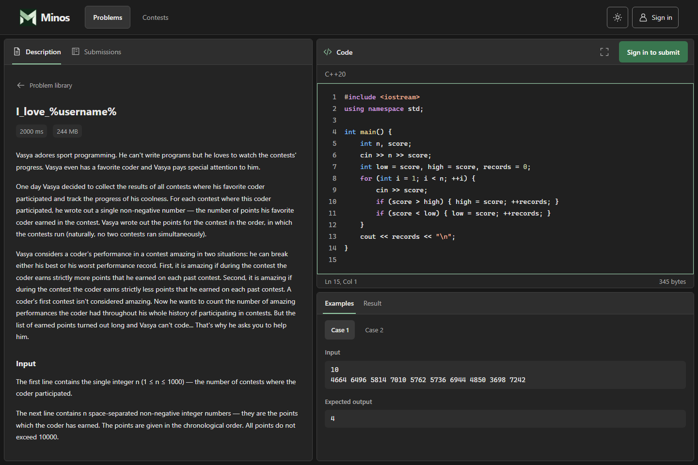
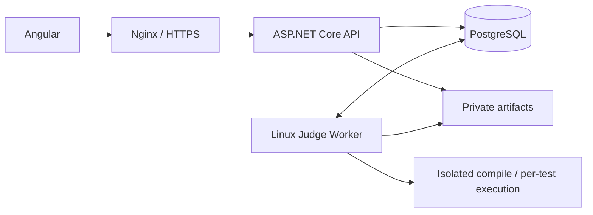

# Minos

A programming practice platform with a C++20 judge, immutable problem versions, practice contests and threaded discussions.

Built with **ASP.NET Core / .NET 10**, **Angular 22**, **PostgreSQL** and **Docker**.



[Problem library in light mode](docs/images/library.png). Screenshots use local development data; fresh installations start empty.

## Features

- **Problem library:** search, difficulty/topic filters, stable public numbers and personal solve progress.
- **Solve workspace:** statement and examples alongside a C++ editor, submission tracking and private history.
- **Official judging:** pinned GCC toolchain, isolated execution for every test, seven verdicts and measured CPU/memory usage.
- **Practice contests:** organizer authoring, registration, immutable problem selections and server-enforced submission windows.
- **Discussion:** two-level threads, spoiler controls, safe Markdown, author editing/deletion and administrator moderation.
- **Accounts:** password authentication, profile/security settings, role-based permissions and revocable cookie sessions.
- **Reliability:** atomic admission, idempotent submission requests, leased jobs, bounded retries and crash recovery.

## Run locally

Requires Docker Compose v2 and a Linux Docker engine with cgroup v2. On Windows, use Docker Desktop's WSL2 engine. Python 3 is used once to generate local credentials. Allocate at least two CPUs and enough memory for the judge, API and database.

```sh
python scripts/prepare-docker.py
docker compose up --build -d --wait
```

Open **[https://localhost:8443](https://localhost:8443)**. The first build downloads dependencies and the pinned compiler image.

Compose provisions PostgreSQL roles, applies migrations and grants, initializes private storage/certificates, then starts the API, Worker and web server. New databases start with an empty problem library; test data and private artifacts are not included in Git.

The generated `.env` contains private credentials. Preserve it when reusing the database volume. Google authentication is disabled in the default local profile.

For browser certificate trust, create `artifacts/` and export the public local CA:

```sh
docker compose cp web:/certs/ca.crt artifacts/minos-local-ca.crt
```

Import that public certificate into your user trust store. See [development setup](docs/development.md) for Windows instructions and configuration.

```sh
docker compose ps
docker compose logs --tail 50 worker
docker compose stop
docker compose start --wait
```

`stop` and `down` preserve volumes. `down --volumes` deletes local data.

## Architecture

The backend is a modular monolith with a separately hosted Linux judge. PostgreSQL owns durable admission, leases and results; submitted programs execute only inside sandboxes.



| Directory | Purpose |
| --- | --- |
| `src/Minos.Domain` | Business invariants and state transitions |
| `src/Minos.Application` | Use cases, authorization and persistence/execution ports |
| `src/Minos.Infrastructure` | EF Core, Identity, storage and sandbox adapters |
| `src/Minos.Api` | HTTP contracts, authentication and host composition |
| `src/Minos.JudgeWorker` | Job processing and independent lease renewal |
| `tests` | Domain, use-case, architecture, PostgreSQL and execution tests |
| `web/minos-web` | Angular application and browser tests |
| `docker` | Images, reverse proxy, initialization and test Compose overlay |
| `scripts` | Database, verification, operations, import and benchmark tools |

See [architecture](docs/architecture.md) and [judging](docs/judging.md) for transaction boundaries and execution semantics.

## Development and tests

Backend development requires the SDK selected by `global.json`. Frontend development uses Node.js 24 and the committed npm lockfile.

```sh
dotnet restore Minos.sln --locked-mode
dotnet build Minos.sln -c Release --no-restore
dotnet test tests/Minos.Domain.Tests -c Release --no-build
python scripts/problem-bank/test-problem-bank.py

cd web/minos-web
npm ci
npm test
npm run build
```

The full backend suite uses real disposable PostgreSQL and Linux sandboxes. Browser tests exercise the production SPA with isolated API fixtures; a separate HTTPS smoke check exercises the running API/Worker. Commands and prerequisites are in [development and verification](docs/development.md). CI runs the backend acceptance pipeline and frontend build, audit, unit and browser tests.

## Documentation

| Guide | Contents |
| --- | --- |
| [Architecture](docs/architecture.md) | Project boundaries, data ownership, authorization and consistency |
| [Judging](docs/judging.md) | Verdicts, resource limits, scheduling, isolation and native runtime |
| [Development](docs/development.md) | Local setup, configuration and reproducible test commands |
| [Operations](docs/operations.md) | Upgrades, diagnostics, recovery, backup/restore and retention |
| [Problem data](docs/problem-data.md) | Dataset provenance, import, classification and integrity checks |
| [UI conventions](docs/ui.md) | Navigation, themes, interaction and frontend boundaries |

## Scope

Minos currently targets local development on a single judge host. Production deployment and public capacity policies remain open. Custom-input Run, manual rejudge, leaderboards, ratings, realtime updates and distributed workers are not implemented. Google OAuth integration needs real-provider verification; browser account linking and email-based recovery are incomplete. Problem authoring is available through the API and contest workflow; a standalone authoring dashboard is still pending.
