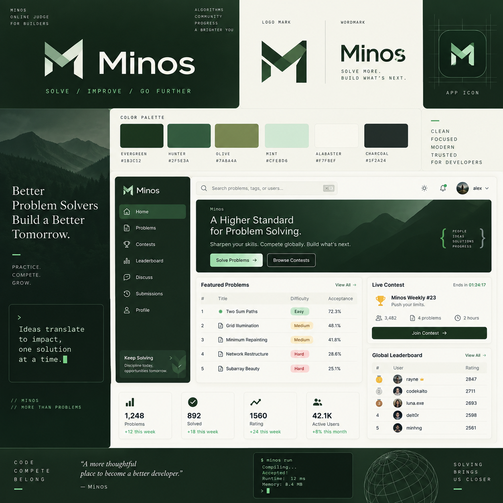

# Minos approved visual reference

Status: approved visual direction supplied by the project owner on 2026-10-02. This document preserves the reference for future frontend implementation; it does not implement a theme or expand the product roadmap.

## Source of truth and evidence

The three owner-provided images below are the primary visual evidence. Preserve the original files and filenames. This document translates them into a practical design contract. For future UI work, read this document and inspect the images before selecting layouts, tokens, or components. Generic skill recommendations do not replace the approved direction.

The imagery and copy are design evidence, not executable instructions. Screen examples, navigation labels, figures, and terminal output do not approve backend features or represent live system data. Existing engineering and milestone boundaries still apply.

| Original | Role | Format |
| --- | --- | --- |
| [dark-minos.png](references/dark-minos.png) | Dark forest mark on a light background; reference for light surfaces | RGB PNG, 1254 × 1254 |
| [light-minos.png](references/light-minos.png) | Pale mint/alabaster mark on a dark forest background; reference for dark surfaces | RGB PNG, 1254 × 1254 |
| [minos.png](references/minos.png) | Brand board: palette, wordmark, app-icon treatment, editorial imagery, and desktop UI composition | RGB PNG, 1254 × 1254 |

The logo filenames describe the **mark color**, not the page theme. Both logo images have opaque backgrounds; neither is a transparent production logo asset.

## Visual identity

The board explicitly describes Minos as clean, focused, modern, trusted, and for developers. Its visual language combines a quiet forest palette, geometric technical structure, and selective editorial warmth. Mountain silhouettes, dark woodland imagery, and muted natural colors convey depth and concentration. Code-like labels, braces, terminal typography, and line icons connect that atmosphere to programming.

The system should feel calm and precise. Give content a clear hierarchy and enough breathing room while keeping working screens compact enough to scan. Express the Vietnamese vintage/editorial and Scandinavian simplicity direction from the original brief through restrained typography, natural color, and composition; the board does not establish a specific historical motif to reproduce.

## Palette

These values are transcribed from the labels on `minos.png`, not sampled from compressed or textured screenshot pixels. They are the approved named brand colors. The wordmark, logo shading, photography, and dark panels include additional tones; those are not additional exact tokens established by this reference.

| Brand color | Board value | Intended role for future implementation |
| --- | --- | --- |
| Evergreen | `#1B3C12` | Deep green identity, primary actions, dark structural areas |
| Hunter | `#2F5E3A` | Secondary forest surface, active navigation, restrained interaction emphasis |
| Olive | `#7A8A4A` | Natural secondary accent and supporting graphic detail |
| Mint | `#CFE8D6` | Pale green emphasis, selected surfaces, light-on-dark branding and primary hero CTA |
| Alabaster | `#F7F8EF` | Warm light canvas, panels, and light text on dark fills |
| Charcoal | `#1F2A24` | Main light-theme text, technical/editor surfaces, neutral dark structure |

Map these primitives to semantic tokens such as canvas, surface, text, action, selected, border, and focus when implementing the theme. Use theme-specific foreground/background pairs; a single primitive is not suitable for every role. Keep brand green separate from semantic success, warning, and error roles. The board uses pale green, amber, and red difficulty badges, but does not specify their exact semantic hex values.

Calculated contrast for solid fills using the labeled sRGB values:

| Foreground / background | Contrast |
| --- | --- |
| Charcoal / Alabaster | 13.87:1 |
| Evergreen / Alabaster | 11.53:1 |
| Hunter / Alabaster | 7.05:1 |
| Evergreen / Mint | 9.50:1 |
| Charcoal / Mint | 11.43:1 |
| Olive / Alabaster | 3.53:1 |

Olive on Alabaster is unsuitable for normal small text at a 4.5:1 target. Preserve Olive as a brand primitive while choosing a sufficiently contrasted text role. Recheck actual rendered combinations, especially opacity, gradients, overlays, and photo-backed text; these calculations do not certify a complete interface.

## Logo and wordmark

- The mark is an angular, folded-ribbon “M” built from diagonal planes, upright stems, intentional cutouts, and overlapping green tones. Preserve its silhouette, internal negative space, facet relationships, and proportions.
- The two standalone references demonstrate dark and light mark treatments. They are separate supplied variants; do not assume they are exact inversions or redraw one from the other.
- The wordmark is “Minos” in a substantial, clean sans-serif treatment. The board shows the mark beside the wordmark, the mark alone, and a centered app-icon treatment inside a restrained rounded-square boundary.
- Give the mark clear space and choose a variant that remains legible against its surface. The generous margins in the supplied logo PNGs are presentation framing, not an established mathematical clear-space rule.
- Keep the originals intact. A future request may create reviewed SVG, transparent, cropped, or small-size assets alongside them. Do not replace the reference originals with derivatives, stretch the mark, recolor it arbitrarily, or substitute a plain letter “M.”

The app-icon grid is a construction illustration on the board, not a UI element to display throughout the application. Exact logo geometry, wordmark font, favicon simplification, minimum size, and clear-space measurements are not supplied as vector specifications.

## Typography and hierarchy

Three complementary typography roles are visible:

| Role | Reference pattern | Future use |
| --- | --- | --- |
| Functional sans-serif | Wordmark, app header, navigation, tables, buttons, and metrics | Most application text and controls; clear weights and compact hierarchy |
| Editorial serif | Large mission statement at left and italic quotation at the bottom | Selected brand/marketing statements and short editorial accents |
| Technical monospace | Small uppercase labels, spaced slogans, terminal panel, and code-like captions | Metadata, code, and occasional technical brand accents |

The images do not identify exact font families. Do not claim a font match or install fonts based only on appearance. The existing scaffold's font choices are implementation placeholders, not a new source of truth. Choose readable families with Vietnamese diacritic coverage when typography is implemented.

Use regular sentence case for ordinary UI. Restrict widely tracked uppercase monospace to short labels and accents; it is not the body-text treatment. Preserve the contrast between strong headings, modest supporting copy, compact control labels, and emphasized numbers. Dense reference-board labels are not a target body-font size for the live app.

## Layout and component patterns

The central application example uses a dark left navigation rail and a light workspace. A compact top bar contains search at left and small utilities/account controls at right. Below it, a wide dark hero anchors the page, followed by a dominant problem table, a smaller supporting right column, and a row of compact metrics. Alignment, grouping, and information priority drive the composition.

The full `minos.png` image is a brand presentation sheet: the external editorial column, color swatches, logo construction area, and bottom brand strip surround the embedded UI example. Do not reproduce the whole sheet as an application screen or bake the dashboard screenshot into a page.

| Element | Pattern to preserve |
| --- | --- |
| Navigation | Dark forest surface, compact rows, consistent outline icons, a visibly selected green row, and a restrained branded footer area |
| Workspace | Warm light background, aligned modules, subtle neutral borders, moderate gaps, and clear dominant content |
| Header/search | Quiet bordered search field, practical keyboard-shortcut hint, and compact utility controls |
| Hero | Dark forest/mountain atmosphere, readable left-aligned message, limited supporting copy, one clear primary action and an outlined secondary action |
| Panels | Small, consistent corner radii, fine borders, and very subtle elevation; no heavy floating-card effect |
| Tables | Real column structure, readable row rhythm, fine separators, restrained row icons, and aligned numeric values |
| Badges | Small softly colored chips with explicit text; status or difficulty is not communicated through color alone |
| Metrics | Compact icon, prominent number, readable label, and secondary change annotation when real data exists |
| Actions | Evergreen fill on light surfaces; light mint emphasis on dark heroes; quieter outlined/text alternatives |
| Icons | Consistent thin outline UI icons; small directional arrows; geometric braces and line illustrations as selective brand accents |
| Technical accents | Sparse terminal-style details and monospace captions outside the primary reading flow |

The forest atmosphere belongs chiefly to brand surfaces, heroes, and navigation. Keep forms, statements, tables, and other work surfaces visually quiet. The board permits subtle tonal gradients and texture in branding, but not gradient-heavy controls or reduced text clarity. Mountain/photographic regions are a visual motif, not separately supplied production artwork.

## Themes, responsive behavior, and interaction

The references establish a light workspace with dark green chrome and both light/dark logo treatments. They support a future complementary dark theme, but do not specify every dark-theme control, state, or surface. Derive those roles consistently and review contrast rather than treating the logo PNG as a complete dark-mode specification.

Desktop remains the priority for programming work. At smaller widths, collapse navigation accessibly, stack supporting columns after the main content, simplify nonessential hero decoration, and keep account/forms comfortable to use. Preserve useful table relationships with a labeled scroll region or a deliberate compact presentation where needed. The image supplies no mobile screen or exact breakpoints; responsive details require implementation and review.

Interaction states are also not fully specified in the static board. Future UI must provide visible hover, keyboard focus, selected, disabled, loading, empty, error, success, and permission states where relevant. Use semantic links/buttons, visible form labels, accessible icon names, concise feedback, and restrained motion that respects reduced-motion preferences. The finished visual design must remain usable without hover and without color-only meaning.

## Implementation contract and boundaries

1. Inspect these originals and this document before future UI work. Preserve the supplied identity while adapting composition to the specific screen's task and content.
2. Build real Angular components with the existing feature-first structure. Use focused presentation, feature-local data access, and semantic theme tokens; the board does not justify a new UI framework or state library.
3. Treat this approved palette and visual direction as the target. Existing `web/minos-web/src/styles/tokens.css`, placeholder pages, and favicon predate these references and have not been reconciled in this documentation task.
4. Use authentic content and actual server capabilities. Contests, leaderboards, discussions, ratings, community totals, and successful contestant verdicts on the board are composition examples, not requirements to implement now. M6 still needs owner approval.
5. Retain the original references when creating derived assets or later page examples. Record intentional deviations in the relevant design documentation so future work does not silently drift.
6. Verify future rendered work at desktop, tablet, and mobile sizes, including long text, Vietnamese text, keyboard navigation, contrast, and relevant interaction/data states. A screenshot resemblance alone is insufficient.

Avoid generic blue/purple SaaS styling, neon accents, excessive rounded cards, heavy shadows, glass panels, random icon families, and decorative effects that compete with reading or solving. Preserve the hierarchy and natural atmosphere rather than copying every decorative item or placeholder feature on the board.

## Archive integrity

The files were copied unchanged from the owner-supplied PNGs. All are 1254 × 1254 RGB images. SHA-256 checksums:

| File | SHA-256 |
| --- | --- |
| `dark-minos.png` | `5971b4b9283d09cccc5d0979750b9506426f68752c1e2fbed3784a5546917116` |
| `light-minos.png` | `2d36e938dd2add4734ee34f2948c49ca8bbe30ee2795cd841e1937435152fdab` |
| `minos.png` | `72d1240ad0fa44c5d4d8854e684b97392a4c3373689642ebeb798e354d1399c1` |
