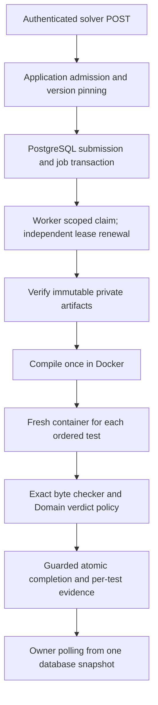

# M6 official judging

Date: 2026-09-30  
Status: M6 complete; M7 not started

M6 connects the durable M5 submission lifecycle to real compilation and private tests. It establishes reproducible contestant verdicts and retained evidence before M7 reliability work. The project owner's accepted policies are recorded in [ADR 0009](../adr/0009-official-judging-and-evidence.md).

## Implemented flow

The five production projects and dependency boundaries remain intact. Submitted code never executes in the API or Worker process. Only source/executable and the current stdin are copied into a private Linux-native workspace and mounted read-only. Expected answers remain in the trusted Worker. The Docker adapter enforces network/resource/privilege boundaries and returns structured exit, limit, snapshot and cleanup evidence. Infrastructure failure never becomes WA or RE.

Compilation occurs once per attempt. Ordered tests stop at the first failure; later tests retain NotExecuted with null metrics. Domain protects verdict/evidence consistency and complete Accepted outcomes. Summary CPU, wall and memory are maxima over executed tests, excluding compilation. Detail shows the pinned version/configuration and accepted attempt, while history omits source. Neither projection returns hidden contents or runtime output.

The Worker renews every ten seconds using a separate scope. The completion repository reloads the locked persisted lease, rejecting stale attempts and accepting duplicate completion idempotently. Processing scopes remain alive through cancellation and cleanup. Detail queries use RepeatableRead so a poll cannot mix pre-completion status with newly committed attempts/results.

## Important implementation files

| File/class | Responsibility |
| --- | --- |
| Domain `JudgingOutcome`, `JudgingPolicy`, `SubmissionResult`, `TestCaseResult` | Legal verdicts, precedence, first-failure shape, required evidence and immutable completion data |
| Application `ExecutionPorts`, `OfficialJudgingPolicy`, `JudgeJobUseCases` | Backend-independent execution contract, exact comparison and job orchestration |
| Application `SubmissionUseCases` | Active-owner authorization and safe pinned-configuration/result projections |
| Infrastructure `OfficialSubmissionExecutor` | Load pinned tests, verify artifacts, compile once, execute ordered tests and collect outcomes |
| Infrastructure `DockerExecutionBackend`, `DockerExecutionSession`, `DockerProcessGuard` | Container limits, bounded output, daemon process evidence, descendant termination and cleanup |
| Infrastructure `ProblemArtifactStore` | Bounded, checksum-verified private reads and link/path rejection |
| Infrastructure `JudgeJobRepository`, `SubmissionRepository` | Guarded result transaction and coherent owner polling |
| Worker `SubmissionJobWorker` | One scoped job at a time, independent renewal and cancellation propagation |
| API `SubmissionContracts`, `SubmissionEndpoints` | Explicit owner-only HTTP projections; no Domain entity exposure |

## Database and migration

`20260930142219_M6OfficialJudging` adds verdict, bounded compiler diagnostics and resource summaries to `evaluation.submission_results`, plus `evaluation.test_case_results` with ordered statuses, exit/limit evidence and nullable metrics for NotExecuted. A composite foreign key binds every test to the accepted result/attempt. Constraints require measurements for executed tests and enforce unique order. Prior migrations are unchanged.

Old M5 lifecycle markers survive with null verdicts and no synthetic metrics/tests. New completions require a validated outcome covering the pinned private-test count. API privileges add result/test reads; Worker privileges add immutable published specification/test-metadata reads and result/test inserts. The Worker still has no credentials/account access or authoring writes. Runtime roles cannot rewrite/delete result history.

## Evidence

Validation runs in WSL2 Ubuntu 22.04 with .NET 10, Docker/cgroup v2, the pinned GCC 14.3.0 image and isolated PostgreSQL 18.6. Windows builds keep their restore assets separate.

- Final Windows and clean Linux Release builds pass with zero warnings/errors. The full Linux foundation run passes 19 Domain tests and 124 integration tests; its only skip is the Windows ACL test. Seven selected Windows architecture/policy/ACL tests pass separately. TRX evidence is in `artifacts/tests` (final Linux files dated `2026-09-30_22_10_46` and `22_10_47`, plus `m6-windows.trx`).
- Fresh/repeated migration and upgrade from seeded M5 completion history pass.
- Real PostgreSQL tests cover pinned v1 after v2 publication, first failure, restart/history/privacy, missing/corrupt artifacts, runner/snapshot faults, renewed lease visibility, result-count/measurement/attempt constraints and completion during polling.
- Real Docker tests cover correct compilation/execution, forked children holding output pipes, PID exhaustion, cancellation cleanup and silent long-running execution.
- The HTTP fixture registers a distinct Solver, publishes a three-test A+B definition and checks AC, WA, CE, RE, TLE, MLE and OLE through the actual Worker. WA passes the first test, fails the second and leaves the third NotExecuted.
- A second immutable definition permits three 11-second runs. It must complete Accepted in one attempt after more than 30 seconds, with persisted lease extension.
- Storage privacy/readiness, database outage/restart, both hosts and all existing architecture/account/problem/job tests remain in the foundation pipeline. Windows separately validates private storage ACLs.

Run the trusted fixture validation with the README's pinned-image preparation followed by `bash scripts/check-foundation.sh`. CI uses the same acceptance script and prepares the image separately on cold hosts. Results are temporary developer fixtures; no reference source or execution publication gate is introduced.

## Important findings and limits

Docker's exec/attachment can outlive the actual main process when descendants inherit output handles. Daemon PID/state observation plus a reserved termination guard prevents that delay from becoming a false TLE. Running execs can temporarily have no PID or exit code; those states require waiting, not fabricated evidence. A UID-wide process limit interfered with WSL host processes and was replaced by container PID containment.

CPU/memory measurements include small trusted container overhead. Wall observation has polling/control-plane resolution. The adapter requires supported Docker daemon/cgroup evidence and runs only as a non-root Linux user. These are developer acceptance results, not production capacity or sandbox certification.

Production judge hosting/Isolate, throughput and fairness targets, hard-crash orphan-container/workspace recovery, broad retention, manual rejudge, custom Run, other languages, contests, ratings and push/distributed execution remain deferred. Live Google validation remains the M3 limitation. GitHub-hosted CI execution is pending commit/push. Only disposable validation databases were migrated; apply the new migration and runtime grants before using an existing development database with the updated hosts.

## Completion

- [x] Final full foundation pipeline and new M6 tests pass (`foundation_checks=passed`).
- [x] Real API verdict matrix, pinned configuration and private result projections implemented.
- [x] Infrastructure failures preserve the retry/SystemFailed boundary.
- [x] Historical M5 data and immutable problem versions survive migration.
- [x] Long-running execution completes under a renewed lease in one attempt.
- [x] Architecture rules retained; no new production projects or speculative dependencies.
- [x] M7 has not started and requires project-owner approval.
